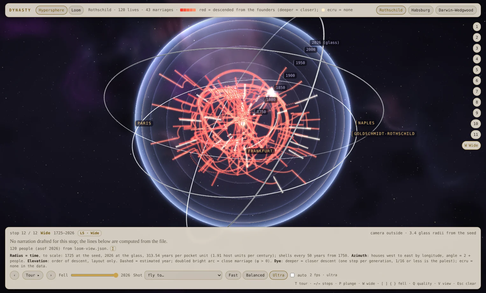
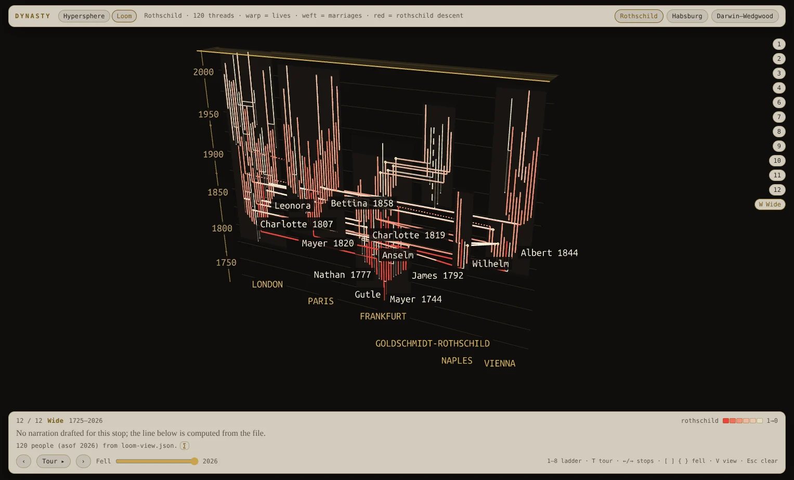

# Dynasty Loom (v2, prepared as Artifact version 4)

Three families' public genealogy drawn as X3D 4.0 scenes in X_ITE 16.5.1: the Rothschilds (120 lives, 43 marriages), the Habsburgs (106, 39) and the Darwin–Wedgwoods (76, 12). One page, two views:

- **Hypersphere** (the default view). Each family is a glass sphere of time.
- **Loom.** Each family is a tapestry on a loom.

Both views read the same person cards, so the narration, sources and grades match.

**Live:** [Dynasty Loom on claude.ai](https://claude.ai/artifact/BRwe3b1L48fAkxDzDsvcm1). It is a private Artifact. Version 3 was published on 30 October 2026, and `release/v3/` holds exactly the bytes that version serves.

**v5** keeps v2 and gives the hypersphere a camera the page owns and an optional hyperbolic lens; it is prepared as version 5 of the same Artifact. See [v5](#v5-artifact-version-5) below.

**v2** (branch `dynasty-loom/v2`) adds a theme system, portraits that arrive with the camera, and fixes v3's rough edges; it is prepared as version 4 of the same Artifact. See [v2](#v2-artifact-version-4) below. The sections after it describe v3, which v2 builds on.

| Hypersphere | Loom |
|---|---|
|  |  |

## v5 (Artifact version 5)

v5 keeps v2's data, looks and scenes, and changes how the hypersphere moves. Both new parts live in `hyper/nav/` and ship beside the page as `lib/orbit.js` and `lib/lens.js`; `window.dynastyNav` (state, flyTo, focus, select, setLens, lensState, map, project, recStart and recStop) is the small surface the gates drive.

The portraits changed too: the portrait manifest was regenerated on 31 October 2026, so all 26 portrait subjects now have labelled AI portraits and none uses the shared silhouette (v4 had 6 AI portraits and 20 silhouettes). Amschel's label now reads "1840s", and 6 earlier images have new bytes. Every image still carries its label; the 20 new portraits and their labels need the same review the first 6 had.

- **The page owns the camera** (`hyper/nav/orbit.js`). The Probe viewpoint binds `NavigationInfo DEF='NavNone' type="NONE"`, so X_ITE adds no navigation of its own; clicks still reach the scene. One camera state (pivot, distance, orientation, field of view, view shift) takes every move: drags, the wheel, keys, momentum, the idle orbit, the double-click re-centre, the lens eases and the tour's flights. A hand-off can change the speed, never the pose.
  - Drag orbits as a turntable about the sphere's axis, with the pitch clamped and the horizon eased level. Shift-drag turns freely. Right- or middle-drag, Alt/Ctrl-drag or two fingers pan. The wheel or a pinch zooms toward the pointer. The arrows orbit 15° and 9° a press; a held arrow turns at a steady 75°/s, eased in and out (each key repeat used to add another 15°). `+` and `-` zoom, `0` flies back to the opening view and `L` toggles the lens. The tour stops moved from the arrows to PageUp/PageDown and `,` `.`.
  - A click selects: the lineage lights and the card opens. A double-click or double-tap re-centres on the person the first click picked, so a scene that moved between the two clicks cannot change who. On touch the card opens after the 450 ms double-tap window, so it never covers the second tap.
  - Momentum decays as exp(−t/0.36 s), integrated exactly, so the coast does not depend on the frame rate. The first momentum frame integrates from the last move the drag applied, so it neither steps twice nor stalls for a frame, and the pointerup's own move is applied. A coasting globe carries its momentum into a flight. A pinch is applied once a frame, at the start of the page's frame, so it lands in the frame it was made in. In a pinch, a twist under 0.12 rad does not roll the view, and a twist that stays under 0.35 rad eases level when the pinch ends, until the horizon is within 0.05°. Under `prefers-reduced-motion` there is no momentum and no idle orbit, eases last at most 200 ms, and every flight (the tour's and the plunge's 7 s leg) is cut to 0.3 s.
  - The view shift slides the camera parallel to the view, so the pivot sits in the middle of the area the header, caption and rail leave free (and the card's, on a phone, where it covers the globe, or wherever the card would cover the person just clicked: the shift then brings the clicked point of their fiber into the free area). The drawn camera therefore sits off each shot's authored position by design; the hypersphere gate bounds the pivot's offset at 0.15 of the smaller viewport side.
  - The Host and the plunge's first leg are flights now. The Flywheel shot is the idle orbit from wherever the camera is (after `?idle_ms`, default 40 s).
- **The hyperbolic lens** (`hyper/nav/lens_glsl.py`, `lens.js`). It is an optional Poincaré-ball view behind a quiet "Lens" button in the header, off at load. The person in focus is magnified and the rest recedes toward the glass. A chip and the scale line say that distances are then not to scale.
  - The maths: pocket point p → ball point x = c·g(|p|/R)·p/|p|, with g(s) = tanh(k s)/tanh(k); then x′ = (−a) ⊕ x (Möbius addition); drawn at mix(p, R·x′). The generator patches it into `fiber.vert`, `fiber.frag`, `shell.frag` and the armillary's `ring.frag`, and JS and Python mirror it. Numbers: c 0.92, k 1.35, fade from hyperbolic distance 1.6 to a floor of 0.3 at 4.4, toggle ease 1.1 s, focus ease 1.2 s.
  - The time shells warp with the scene (a Möbius map sends spheres to spheres). The armillary sits outside the ball, where no Möbius map moves it, so it recedes toward the ground instead.
  - Everything the shaders do not draw goes through the JS mirror: the HTML labels, the portrait overlay, the X3D portrait plates (each in a `PlateLens_*` Transform), the seed and bead, and picking (points past the horizon cannot be picked).
  - A drag moves the focus at half the pointer's speed, measured against the glass's radius on screen (capped at 0.75 of the smaller viewport side, so a close shot, where the glass is far larger than the screen, still answers). Past |a| 0.6 it meets a soft limit that eases toward 0.8 instead of hitting a wall. A lens flick keeps its release speed and coasts at most a quarter of that radius (170 px at most), about 0.12 in |a|. With the lens on, a wheel-in notch also pulls what is under the pointer part of the way toward the centre. Turned on at the opening view, the lens eases its focus to the next close stop's subject (at the seed it showed almost nothing). On a phone with the lens on, only the focus's house keeps its name.
  - What the lens magnifies stays in proportion: the seed and the bead take at most 1.25x of its scale, the night look's bead glow is lowered while it is on, and the bead fades as the lens pushes it under the header. A plate grows at most until it is a fifth of the smaller viewport side tall, and a plate the lens pushes under the header or mostly out of the safe area shrinks away.
  - Plates and names: the subject's portrait overlay takes the first place beside, above or below the subject that is clear of the stop's plates (else the least covered, and the plates under it shrink away while it shows), and the stop's plates are obstacles for every name label, so a name never sits on another person's portrait.
  - Arcs are densified for the lens (`arc_step`), so the scenes are larger: the published set is 18.8 MB in 134 files, against v4's 16.2 MB (inside the Artifact limits: 64 MB, 15 MB a file, 255 files).

The portraits now live in the repo, in `portraits/` (see its README for the sources and licences): the cache of all 26, the manifest, the call log and the generator. `python3 -I dynasty-loom/tools/build_v2.py --manifest dynasty-loom/portraits/manifest.json --release dynasty-loom/release/v5` rebuilds the published set with no network and no image model, and checks it byte for byte against `release/v5/SHA256SUMS` (134 files, matched on 31 October 2026).

Build exactly as v2. `tools/build_v2.py` runs the same stages; `hyper/build_hypersphere.py` loads `hyper/nav/lens_glsl.py` (or `LENS_LIB`) and copies `orbit.js` and `lens.js` beside the page. `node hyper/nav/test_orbit_v5.js` checks the camera fixes above without a browser.

| Claim (31 October 2026, on the v5 candidate) | Grade | Tool |
|---|---|---|
| All 15 scenes validate against the X3D 4.0 schema; the Loom gate with the fork validator finds 0 errors, 0 warnings and 89 notes (fork ok 15 of 15) | Confirmed | xmllint, `loom_gate.py --fork` |
| The hypersphere gate passes 260 of 261 checks with a clean console, including every close stop's portrait and its label, the plates, the 14 new plates-and-names checks, the view-shift bound (0.053 to 0.112 of 0.15 over 52 landings), the look switch, the header at four sizes and the phone layout. The one failure, in both of two runs, is Habsburg's plates fade-out (2107 and 2014 ms against 1700): see the rough edges | Confirmed (2 runs) | `hyper/tools/gate_hyper.js --artifact` |
| The loom gate passes 66 of 66 | Confirmed | `tapestry/tools/gate_loom.js --artifact` |
| The page loads under a strict copy of the Artifact CSP: 19 of 19 checks on desktop (light) and on phone (dark, Documentary Night) | Confirmed here; Likely on the real host | `tapestry/tools/artifact_csp_gate.js` |
| Double-click and double-tap re-centre on the person the first click picked (desktop 60 of 60 with the lens off and on, phone 15 of 15), the card never covers the second tap, a click does not slide the scene, the re-centre never swings outward, a coast carries into a flight | Confirmed (virtual 60 fps clock) | nav `interaction_gate.js` |
| Every tour runs to its end on the page-owned camera, lens off (3 families) and on (Rothschild); every family loads with the Probe bound and NavigationInfo NONE under the strict CSP on desktop and phone; the GLSL lens matches its JS mirror within 0.6 px | Confirmed | nav `tour_check.js`, `csp_gate.js`, `glsl_vs_js.js` |
| A lens drag stays inside the soft limit (focus radius 0.784 at most, limit 0.8) and the glide keeps its release speed (first glide step 0.0412 against the last drag step 0.0424); with the lens on, all 6 close Rothschild stops show the portrait with its portraits.json label (overlay and plates), console clean | Confirmed (virtual clock) | nav `lens_v5_check.js` |
| Unit tests: the lens maths in Python (12) and JS (5901 checks, JS against Python within 3.3e-16), the camera core (47) and the v5 camera fixes (26) | Confirmed | `test_lens_math.py/js`, `test_orbit_core.js`, `hyper/nav/test_orbit_v5.js` |
| Review fixes, checked live: an 80 px drag at the Host moves the lens focus to 0.40 (limit 0.45) and a 200 px drag at a close stop still moves it (0.14); a wheel-in with the lens on pulls the person under the pointer toward the centre; reduced motion caps flights at 0.3 s; at every close stop with plates, at 1280x720, 1366x768, 1527x923, 1920x1080 and a 400x860 phone (light and dark), with the lens off, toggled on and on through the flight, no plate sits under the portrait, no name sits on another person's plate, no lens-on plate sits under the header, and the bead ring stays within 1.4x its lens-off size | Confirmed (virtual 60 fps clock) | `fix_checks.js` (review harness, outside the repo) |
| No possibly-living person: the publish gate passes over 302 people in the cards; 26 people have AI portraits, each with its label | Confirmed | `make_artifact.py` |
| Median frame interval is 1.2x v4's (lens off; 1.11x to 1.39x by family, shot and tier) | Likely (SwiftShader, relative only; 24 frames, 1 round) | `hyper/tools/perf_compare.js` |

Gate changes (each keeps the check's intent where the old form assumed X_ITE's navigation; marked `v5 nav` in the scripts):

- `gate_hyper.js`: the Host shot at load is the Probe bound with NavigationInfo NONE and the camera core on the Host pose (it was the Host viewpoint bound). Landing on a shot checks the core's pose against the shot (position before the view shift within 0.002, direction and up within 0.1°) and that X_ITE drew the commanded pose; a flight that moved must have sensed samples, which is stricter than before. FLY and EXAMINE became NONE everywhere. Host and the plunge's first leg are flights; the Flywheel is the idle orbit. A click selects and leaves the camera still (the fiber stays within 2 px), and a new check has a double-click re-centre. The right arrow orbits 15° (measured once the ease ends) and PageDown steps the stop. On a phone the tap check waits up to 5 s for the card, which opens after the double-tap window, instead of a fixed 900 ms.
- `artifact_csp_gate.js`: `hyper_host_bound` is now the Probe with NavigationInfo NONE holding the Host shot's pose within 0.002 and its view direction within 0.1° (it was the Host viewpoint bound).
- After the v5 review, added (nothing removed): `gate_hyper.js` bounds the view shift in every landing (the pivot at most 0.15 of the smaller viewport side from the canvas centre), and at every close stop with plates, on desktop and phone, checks that no shown plate sits under the portrait overlay and that no name label sits on another person's plate. `test_orbit_v5.js` grew from 18 to 26 checks (the release a frame after the last move, the pointerup's own move, a held arrow key, a twist just past the dead zone, the page's lens coast cap, the pinch flushed at the frame start).

Known rough edges (v5):

- Frames are about 1.2x slower than v4's on SwiftShader, and slower still in flight. A likely cause is the lens's denser arcs (27% more points in the pockets); per-frame page work may add to it. The plates' fade-out check depends on frame time: it passed in four hypersphere-gate runs before the review fixes (908 to 1417 ms) and failed in one (Habsburg, 2826 ms, against a limit of 1700 ms); after the fixes Habsburg failed it in both runs (2107 and 2014 ms) while Rothschild and Darwin–Wedgwood passed (923 to 1106 ms). The gate's 100 ms samples show the plates' transparency changing only every 0.4 to 1.1 s, so it is SwiftShader's frame interval, not the 0.9 s clock, that sets the measured time; the check is unchanged.
- The header keeps one row at 1527x923 and 1920x1080 and two on a phone (the brand, views and Lens button share the first); at 1280x720 and 1366x768 it still takes two rows, as in v4. With the lens off at Darwin–Wedgwood stop 6, the top of the bead ring can reach that two-row header at those two sizes (the authored shot; with the lens on the bead fades there).
- At Darwin–Wedgwood stop 6 the subject's label can sit just under the portrait card, not beside the fiber.
- A plate the portrait cannot avoid, or one the lens pushes out of the safe area, shrinks away rather than fading (X3D draws each stop's plates with one shared material).
- On a phone the card opens after the 450 ms double-tap window by design. On SwiftShader the gate measured 1.2 to 1.7 s from tap to card.
- Some of the earlier review's lens art direction is still to do: soften the lineage dimming by 40% while the lens is on, and light the spouses and children of in-laws.
- The published set is 18.8 MB, above the 16 MB the build warns at but inside the Artifact limits.

## v2 (Artifact version 4)

v2 keeps v3's data, mapping and gates, and changes how the page looks and what it shows of people.

- **Looks** (`hyper/themes.py`). The page opens in Museum Atlas, a light, printed-atlas look: warm paper, madder and ink, small caps. Documentary Night is the one alternate, behind a quiet "Night" switch in the header; a dark system setting opens on it. On phones (720 px and narrower) the interface takes Editorial Clarity's layout and type, not its colours. A fourth look, Heritage Glass, builds but is not shipped. The dye colours are baked into the hypersphere's vertex colours, so the alternate look ships its own scenes under `theme/documentary-night/`.
- **Portraits.** At close stops the subject's portrait fades in beside the fiber, with its label under it and in its title; neighbours show as small plates in the scene (X3D transparency 0.06). Every image is one of:
  - an AI portrait (status `ok` in the portraits manifest), labelled as AI-made with the public-domain painting it follows ("AI portrait after Moritz Daniel Oppenheim, 1836"), or as imagined where no likeness survives;
  - the shared silhouette placeholder with the person's initials, labelled "Portrait in progress". It is one plain figure for everyone, never a likeness;
  - a lettered monogram, when a release is built without `--placeholders`.

  No one possibly living has a portrait: `tools/build_portraits.py` stops on anyone the cards do not hold, and the cards hold no one possibly living.
- **Fixes from v3's list.** The opening caption, the caption panel's height, the header and stop-rail overlap at 1280×800 and 1366×768 (the gates now check four header sizes), and the plates' clocks (`Date.now()/1000`, because X_ITE 16.5.1 has no public `currentTime`).

The portraits and their manifest live with the portraits workspace, not in this repo, so `release/v4/` holds receipts only. Build:

```sh
python3 -I dynasty-loom/tools/vendor_xite.py --release dynasty-loom/release/v3   # once
python3 -I dynasty-loom/tools/build_v2.py --manifest PATH/portraits/manifest.json \
    --placeholders PATH/placeholders/out --artifact OUT --release dynasty-loom/release/v4
```

`--release` compares the build with `release/v4/SHA256SUMS`. A fuller manifest needs no code change: run it again, and the comparison then lists the portraits that changed.

| Claim (31 October 2026, on the published set) | Grade | Tool |
|---|---|---|
| All 15 scenes validate against the X3D 4.0 schema; the fork validator finds 0 errors and 0 warnings; the Loom gate finds 0 errors, 0 warnings and 89 notes | Confirmed | xmllint, `tools/validate_x3d.py`, `loom_gate.py --fork` |
| The hypersphere gate passes 246 of 246 checks, including each close stop's portrait, label, mask and plates, the look switch, the header at four sizes and the phone layout per family | Confirmed | `hyper/tools/gate_hyper.js --artifact` |
| The loom gate passes 66 of 66 | Confirmed | `tapestry/tools/gate_loom.js --artifact` |
| The page loads under a strict copy of the Artifact CSP on desktop (light) and phone (dark) | Confirmed here; Likely on the real host | `tapestry/tools/artifact_csp_gate.js` |
| Median frame interval is 0.47× v3's (about twice as fast at the fast tier and four to six times at ultra), over 24 frames × 2 rounds per family and shot | Likely (SwiftShader, relative only) | `hyper/tools/perf_compare.js` |

Known rough edges (v2): on the light default look the loading still is not shown; the "Portrait in progress" line under a large plate can sit under a fiber; the orbit camera and hyperbolic lens are not in v2 yet and come with the next version.

## What the views show

**Hypersphere** (`hyper/build_hypersphere.py` 1.2). The mapping is stated on screen:

- **Radius is time, to scale:** the founders' seed at the core and 2026 at the glass, with a shell every 50 years. For the Rothschilds, one pocket unit is 313.5 years.
- **Azimuth:** houses run west to east by longitude, and each house's sector is proportional to 2 + its people.
- **Elevation:** order of descent. It is layout only, and the page says so.
- **Fibers:** a life is a glowing fiber from r(born) to r(died). It bends on the shell of a move, and is dotted where a year is estimated.
- **Arcs:** a marriage is an arc on the shell of its year, doubled when the couple share founders.
- **Dye:** each fiber is dyed by its share of descent from the founders. Ecru means an in-law.
- **Decoration:** the nebula sky and the pewter armillary carry no data.

**Loom** (`tapestry/build_loom_scene.py`, layout v2):

- **Time runs up the cloth.**
- **Houses** stand west to east by the longitude of their seat, and latitude is a small depth.
- **Warp threads:** each life is an upright warp thread from a birth bead to death. It bends only when the person moves house.
- **Weft picks:** each marriage is a level weft pick, doubled when the couple share founders. It is translucent where the year is estimated.
- **Dye:** the share of descent from each dye's founders. An in-law's thread stays faint until their first wedding.
- **The fell:** the present-year plane, which the slider moves.

Both views have:

- a guided tour per family (12 stops for the Rothschilds, 8 each for the others);
- click for a person card with sources and a grade;
- quality tiers;
- `#hash` routing: `#hypersphere`, `#loom`, `#<family>` or `#loom/<family>`.

**Data:** `data/loom-view.json` (contract: `data/loom-view.md`) holds 302 people. It is the *public-candidate* view written by `ingest/` (`ingest.py` 0.2.0, `loomview.py`). Anyone possibly living is left out, together with any union that touches them. "Possibly living" means born within 110 years of 2026 with no death recorded. `data/loom-view.receipt.json` is that run's receipt. `data/data-issues.json` lists what the tapestry generator found while drawing; none of it is patched in the scene.

## Layout

| Folder | What it holds | Original workspace path |
|---|---|---|
| `data/` | the build's only input, its contract, its ingest receipt, the data issues | `proto/merged/`, `proto/contracts/` |
| `ingest/` | the pipeline that wrote the data, with its config, curated decisions, schema, tests and the GEDCOM 7 prototype (`gedcom7.py`, with a fictional fixture in `fixtures/`). Every person in `fixtures/synthetic-family.ged` is invented. Two of them, `@I10@` Kit /Example/ (born 1962) and `@I12@` Lee /Example/ (born 1995), have no death on purpose: they are the living-filter cases that `tests/test_proto.py` (`test_fixture_privacy`) checks are withheld | `proto/ingest/` |
| `tapestry/` | the loom generator, the loom page, the page merge, the publish stage and the live gates | `proto/scene2/` |
| `hyper/` | the hypersphere generator, the theme table (`themes.py`, v2), its GLSL (`src/`), its page, its tools and gates, its docs (look bible, camera grammar), the Cycles hero-still scripts and the two plates the page shows while loading (`hero/plates/`) | `proto/hyper/` |
| `x3d/` | `build_genealogy_x3d.py` (the first, drum generator; the loom imports its helpers), the Ubuntu Mono TTF label font and its licence; `vendor/x_ite/` is fetched, not committed | `proto/x3d/` |
| `gates/` | `lookgates.py` (frame gates), `datagates.py` (used by ingest), the source gates | `proto/gates/` |
| `release/v4/` | v2's receipts only: `SHA256SUMS` (all published files), `receipt.json`, `publish.json`, `build-v2.json`; the bytes come from `tools/build_v2.py` | new |
| `release/v3/` | the published file set without `x_ite/`; `SHA256SUMS` for all 87 published files, `x_ite/` included; `publish.json` (the Artifact files map, with relative paths); `receipt.json` (the publish stage's receipt, as published) | the published file set |
| `tools/` | `vendor_xite.py`, `rebuild.py` (v3), `build_v2.py` (v2), `build_portraits.py` (v2), `serve_local.py` (view a release locally), `validate_x3d.py` (the x3d_mcp fork validator wrapper) | new; `validate_x3d.py` from the workspace |
| `frames/` | 12 curated stills (WebP) with `receipt.json` (source and sha256 of each) | gate frames, Cycles posters |
| `reports/` | the project reports 01 to 10 | the workspace reports |
| `provenance.json` | every file copied from the workspace: its source path, its sha256 at copy time, and whether it was edited for repo paths | new |

Some text still names the original layout:

- generated text (the `<meta name='data'>` in the pocket scenes, the comment at the top of the merged page);
- docstrings;
- receipts.

That text is kept as it was, so the published bytes do not change. Read `proto/merged` as `data/` and `proto/scene2` as `tapestry/`.

## Rebuild

You need Python 3.13 (standard library only for the build) and network access to registry.npmjs.org once.

```sh
python3 -I dynasty-loom/tools/vendor_xite.py   # X_ITE 16.5.1 from the npm tarball (sha256 pinned) -> x3d/vendor/x_ite/ and release/v3/x_ite/
python3 -I dynasty-loom/tools/rebuild.py       # merge -> loom -> hypersphere -> publish stage into dynasty-loom/build/, then compares with release/v3
```

`rebuild.py` also takes `--out DIR`, `--release DIR`, `--validate` and `--date YYYY-MM-DD` (see the build date below).

`vendor_xite.py` does three things:

- It fetches X_ITE and checks the tarball against its pinned sha256 (`f93bc35f…71be5`).
- It writes the build copy to `x3d/vendor/x_ite/` and keeps the tarball beside it.
- It writes the 65 X_ITE files the release ships under `release/v3/x_ite/`, and checks every one against `SHA256SUMS`. A mismatch fails the run.

`rebuild.py` runs the stages in order, each as its own `python3 -I` process:

1. `tapestry/tools/merge_views.py` builds `tapestry/page/index.html` from `tapestry/page/loom.html` and `hyper/page/index.html`.
2. `tapestry/build_loom_scene.py data/loom-view.json --out build/tapestry --date 2026-10-30`.
3. `hyper/build_hypersphere.py --cards build/tapestry --out build/hyper`.
4. It copies the two Blender plates in.
5. `tapestry/tools/make_artifact.py --out build/tapestry --hyper build/hyper --artifact build/artifact`.

It then compares every published path by sha256, and compares `receipt.json` field by field. It exits 1 if a published file differs.

Generated files are git-ignored and never edited by hand: `tapestry/page/index.html`, `*/out/`, `build/`. Change a generator, `hyper/src/`, a page source or the data, then rebuild. The two loading plates come from `hyper/hero/` (Blender 5.2.3 Cycles, `hero_render.py`, then `hero_finish.py`). They are committed rather than re-rendered.

**Build date.** The three loom scenes (`rothschild.x3d`, `habsburg.x3d`, `darwin_wedgwood.x3d`) carry a build date in two lines: `<meta name='created'>` and the `generator` meta. The date is an input:

- `build_loom_scene.py` (and the drum generator `x3d/build_genealogy_x3d.py`) take `--date YYYY-MM-DD`. Without it they use `SOURCE_DATE_EPOCH` (UTC), and without that, today.
- `rebuild.py` reads the date from the release's loom scenes (2026-10-30 for v3) and passes it on, so the rebuild is byte-identical on any day. `--date` overrides it.

If you run `build_loom_scene.py` by hand on another day without `--date`, those two lines differ in the three loom scenes. Then the publish stage's `receipt.json` also differs in three more fields: `files/rothschild.x3d/sha256`, `files/habsburg.x3d/sha256` and `files/darwin_wedgwood.x3d/sha256`.

## View locally

```sh
python3 -I dynasty-loom/tools/serve_local.py     # after vendor_xite.py; then open http://127.0.0.1:8000/  (--port N, --release DIR)
```

`release/v3/index.html` is an Artifact page fragment, with no doctype and no charset, because the host wraps it in its own document. A plain static server such as `python3 -m http.server` sends it bare. The page still loads, but the browser renders it in quirks mode and reads its UTF-8 text as windows-1252, so the bullets and dashes come out garbled. `serve_local.py` does what the host does:

- It wraps the page in a standards-mode skeleton with `<meta charset="utf-8">`, the same skeleton as `artifact_csp_gate.js`, without the CSP.
- It serves only the paths in `publish.json`, with the content types listed there.
- It binds 127.0.0.1 only.

It never changes the files on disk.

## Gate

```sh
cd dynasty-loom
export X3D_MCP=/path/to/x3d_mcp      # the x3d_mcp checkout: its XSD and its validator
xmllint --noout --schema "$X3D_MCP/src/validation/schemas/x3d-4.0.xsd" release/v3/*.x3d
/path/to/python-with-lxml -I tools/validate_x3d.py release/v3/*.x3d
python3 -I ../gobbler-demiurge/tools/loom_gate.py release/v3/*.x3d
NODE_PATH=/opt/node-tools/node_modules node tapestry/tools/artifact_csp_gate.js --artifact=release/v3   # Chromium path: GEN_CHROME
```

The live gates are `tapestry/tools/gate_loom.js` and `hyper/tools/gate_hyper.js`. They serve the tree over a local http server and drive X_ITE in headless Chromium (SwiftShader). They take their frame-gate Python from `LOOM_GATE_PYTHON`, which needs numpy and Pillow. `build_loom_scene.py --validate` reads `X3D_MCP` and `LOOM_FORK_PYTHON`.

## Publish (the Artifact recipe)

The page is `release/v3/index.html`. The files map is `release/v3/publish.json`: published path to file, with relative paths, so use `release/v3` as the root.

- **Page fragment.** `make_artifact.py` strips the document shell (doctype, html, head, body, metas), because the host wraps the page itself. The page must open with its `<title>`.
- **Scenes as XML.** `.x3d` files are served as `application/xml`, which X_ITE needs. JSON is served as `application/json` and the label font as `font/ttf`.
- **TTF label font.** The labels use Ubuntu Mono as a plain TTF beside the scenes. X_ITE's own WOFF2 goes through a decoder it runs with `new Function`, which the Artifact CSP refuses.
- **Vendored X_ITE.** X_ITE 16.5.1 ships beside the page (`<meta name="loom:xite" content="x_ite/x_ite.min.js">`), and jsDelivr is only a fallback. X_ITE fetches its components, PBR lookup tables, line types and wasm from beside its script, and the CSP admits a CDN for scripts only.
- **Hash routing.** Routing uses a plain `#hash`, with no `/` needed.
- **Pre-publish gates.** `make_artifact.py` checks, before it writes anything:
  - no secret-shaped strings;
  - no possibly-living person in any card or `.hyper.json`;
  - every `.hyper.json` person is in the family's cards;
  - every link host is listed;
  - the Artifact limits (64 MB, 15 MB a file, 255 files).

## Status: what was checked (30 October 2026)

| Claim | Grade | Tool |
|---|---|---|
| `release/v3/` plus the vendored `x_ite/` is byte-identical to the published v3: all 87 files match `SHA256SUMS`, which was written from the frozen v3 set. That set also matches the per-file sha256 in `receipt.json`. | Confirmed | sha256 (Python hashlib) |
| A clean export of this folder rebuilds all 87 published files byte-identically. `receipt.json` differs only in `source` and `hyper_source`, the output paths. `make_artifact.py` is byte-identical to the v3 script, and its sha256 matches the receipt's `script` field. | Confirmed | `tools/rebuild.py` on a `git checkout-index` export, with `vendor_xite.py` |
| The rebuild holds on any day. With the clock faked to 2026-11-02 in `rebuild.py` and in every stage it starts, it still matched all 87 files, because it passed the release's date (2026-10-30). The control run without `--date` stamped 2026-11-02 and changed the three loom scenes. `SOURCE_DATE_EPOCH` gives the same result as `--date`. | Confirmed | `tools/rebuild.py` and `build_loom_scene.py` under a `datetime.date.today()` patch, compared by sha256 |
| Served by `tools/serve_local.py`, `release/v3` renders in standards mode with UTF-8 text on desktop (1527×923, light) and phone (400×860, dark). Both views load all 3 families from the same-origin X_ITE, and all 8 hypersphere shaders compile. The console is empty and no request fails. | Confirmed | Playwright, Chromium 153.0.8010.12, SwiftShader |
| The 9 `.x3d` files validate against x3d-4.0.xsd. | Confirmed | xmllint (libxml 20914) |
| The 9 `.x3d` files have 0 errors and 0 warnings from the fork validator, with XSD and profile ok. Info lines are 16 to 112 per file. | Confirmed | x3d_mcp fork `acdf5c4`, `tools/validate_x3d.py` |
| The x3d.onto Loom gate finds 0 errors in the 9 files. It reports 6 `glsl-logdepth` warnings and 59 precision infos; the warnings are the SeedGlow and ShellShader in each pocket, which write `gl_FragDepth`. | Confirmed | `gobbler-demiurge/tools/loom_gate.py` at x3d.onto `77ae473` (PR #4 branch, sha256 `ec08ef75…`) |
| The same gate at this branch's base (`2fed4ee`) also finds 0 errors. It adds 6 `glsl-int-literal` warnings on `smoothstep(0, …)` in SkyFS and ShellFS, a false alarm that PR #4 fixes. | Confirmed | `gobbler-demiurge/tools/loom_gate.py` at `2fed4ee` |
| The Artifact CSP gate passes on desktop light 1527×923 and phone dark: 19 of 19 checks each. The console is clean apart from three known-harmless entries:<br>• X_ITE's PT Sans UI font, refused by `font-src`;<br>• mikktspace `wasm-eval`;<br>• the local server's `favicon.ico` 404. | Confirmed (local strict-CSP copy); Likely on the real host | `artifact_csp_gate.js`, Chromium 153.0.8010.12, Playwright 1.63.0, node 22.22.0, SwiftShader |
| No possibly-living real person is in any committed file. `data/`, the cards, `.hyper.json` and every other committed JSON hold none. The only people in the repo born within 110 years with no death are the two invented living-filter cases in `ingest/fixtures/synthetic-family.ged` (`@I10@` and `@I12@`; see Layout). | Confirmed | make_artifact's rule, re-run over every committed JSON; the fixture parsed; `python3 -I ingest/tests/test_proto.py EndToEnd.test_fixture_privacy` passes in a clean export |
| No secrets: no key-shaped strings, private keys or assigned API keys. | Confirmed | regex scan of every committed text file |
| No AI model names are in the committed files. | Confirmed | regex scan of every committed text file |
| The hypersphere's live gate on the merged page passed 175 of 175 checks with a clean console (run 3). | Confirmed | `hyper/tools/gate_hyper.js --artifact` (report 10) |
| Run 2 passed 174 of 175, and run 1 passed 171 of 175. The failures were smoothness samples on SwiftShader, so they are flakes of the software renderer. An isolated A/B was smooth 5 of 5 on both the standalone and the merged page. | Likely | `gate_hyper.js`'s own analysis (report 10) |
| The loom's live gate passed 54 of 54 checks with a clean console, and lookgates passed all 41 frames. | Confirmed | `tapestry/tools/gate_loom.js --all-stops` (report 10) |
| The family facts are graded per person in the cards: Confirmed, Likely or Suspected. | as graded | ingest gates (reports 03 and 08) |

## Known rough edges (v3)

v2 fixes the first three (see [v2](#v2-artifact-version-4)). On v2's light default look the loading still is not shown; the dark alternate still shows it.

- The opening caption still describes the tapestry's "upright threads".
- The caption panel is too tall.
- At 1280×800 and 1366×768 the hypersphere's stop rail overlaps the header. The header wraps to two rows and ends at y = 88, while the first stop ('1 Cloth') starts at y = 70 and covers the corner of the Darwin–Wedgwood button. At 1527×923 the header is one row and there is no overlap. The CSP gate runs only 1527×923 and 400×860, so it does not catch this. The fix is to place the rail below the header's measured height and to add both sizes to the gate. Both change the published page, so they wait for the next version. (Confirmed: Playwright measuring the header and the first stop.)
- The landing inside the glass is muddy.
- The camera-smoothness checks can flake on the software renderer (see above).
- Once both views have been opened, two WebGL contexts stay alive. Phone memory is untested.
- The loading still is a build-2 render, so its dyes predate build 3. The caption says it is a still.
- The last art critique scored the hypersphere 6/10. The look is not final.
- `ingest/` reads a harvest, fact-check files and the original upload, none of which are in this repo. It cannot re-run from here; `data/loom-view.json` is its committed output. Its GEDCOM 7 prototype refuses GEDCOM 5.5.1, the version most real `.ged` files use.
- Inlining into the Gobbler is untested.

## What was changed on the way in

- **Paths.** Scripts that pointed into the original workspace now use paths relative to this folder (`Path(__file__)`), or an environment variable whose default matches the old behaviour:
  - `X3D_MCP` for the fork's XSD and validator;
  - `LOOM_FORK_PYTHON` and `LOOM_GATE_PYTHON` for the validator's and gates' Python;
  - `LOOM_BPY_VENV`, used only as a label.

  The edited files are `tapestry/build_loom_scene.py`, `hyper/build_hypersphere.py` (two defaults), `hyper/hero/hero_finish.py`, `hyper/tools/{finish_receipt.py, build_camera_proof.py, gate_hyper.js, probe_look.js}`, `tapestry/tools/{gate_loom.js, write_receipt.py}` and `tools/validate_x3d.py`. `provenance.json` lists each one with its original sha256. Every other script is byte-identical to the one that built v3, except for the build-date change below.
- **Build date as an input** (after review). `tapestry/build_loom_scene.py` and `x3d/build_genealogy_x3d.py` read `--date` or `SOURCE_DATE_EPOCH` instead of always using today. The default is still today, and the published bytes do not change: the rebuild above matches all 87 files. The tapestry stage's own receipt records both dates, `generated` (the day it ran) and `build_date` (the date stamped into the scenes).
- **Reports and the hero receipt.** Absolute workspace paths were shortened to `scratchpad/…`. In reports 01 and 07, the names of the AI models behind some of the original upload's documents were replaced with `[model]`.
- **Left out:**
  - the uploaded zip and anything copied from it;
  - every `.env*` file;
  - `dist/`, `node_modules`, the virtual environments;
  - `work/`, `tmp/` and `out/` folders;
  - the private data build (`proto/merged/private/`, `gates.json`);
  - the full public-candidate exports (`genealogy.*`, `cosmos-datasets.json`), which are not build inputs;
  - development probes (`hyper/hero/probe_*.py`, `scene2/adapt_harvest.py` and its `dev/` view), lookdev scenes, proof builds;
  - all gate frame runs except the 12 curated stills.
